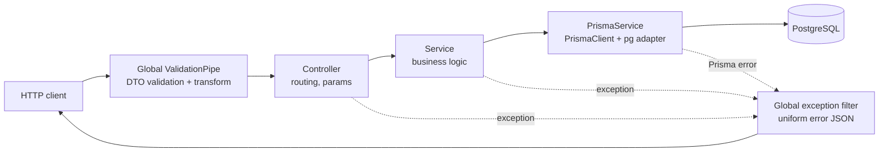
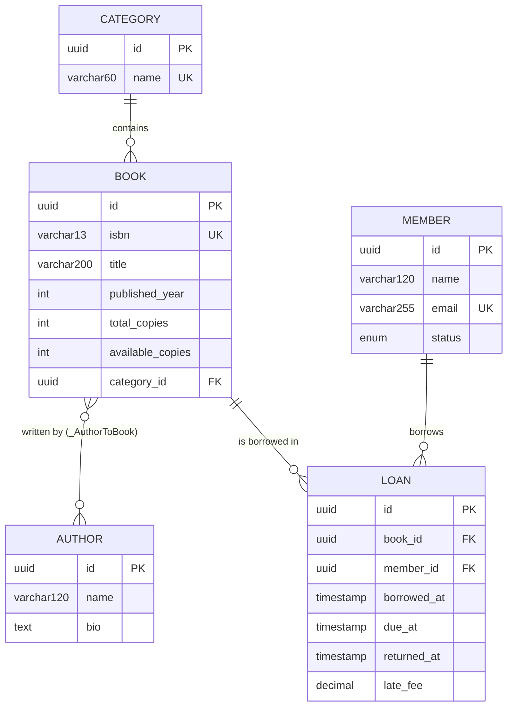

# Architecture

> Status markers: ✅ implemented · ⏳ planned

## Stack

| Layer       | Technology                                                      | Notes                                                                |
| ----------- | --------------------------------------------------------------- | -------------------------------------------------------------------- |
| Runtime     | Node.js 24, **ESM** (`"type": "module"`)                        | Relative imports use `.js` extensions (`nodenext`)                   |
| Framework   | NestJS 12                                                       | Modules, DI, pipes, filters                                          |
| Language    | TypeScript (strict)                                             |                                                                      |
| ORM         | Prisma ORM **7.10** (CLI and client pinned to the same version) | `prisma-client` generator → `api/src/generated/prisma` (git-ignored) |
| DB driver   | `@prisma/adapter-pg` + `pg`                                     | Prisma 7 uses driver adapters                                        |
| Database    | PostgreSQL                                                      | Local: `npx prisma dev` (interim; see ADR-0005)                      |
| Validation  | `class-validator`, `class-transformer`                          |                                                                      |
| API docs    | `@nestjs/swagger` (OpenAPI)                                     | `/docs`, `/docs-json`                                                |
| Tests       | Vitest + Supertest                                              | ⏳                                                                   |
| Lint/format | oxlint, Prettier                                                |                                                                      |
| Frontend    | React                                                           | ⏳ later phase                                                       |

## Repository layout

```
Foundation_API/
├── CLAUDE.md                  # AI instructions index
├── .claude/                   # Claude Code settings, hooks, skills (shared)
├── docs/                      # requirements, architecture, progress, ADRs
└── api/                       # NestJS backend
    ├── prisma/
    │   ├── schema.prisma      # data model
    │   └── migrations/        # SQL migrations (committed)
    ├── prisma.config.ts       # Prisma CLI config (DB URLs from .env)
    └── src/
        ├── main.ts            # bootstrap: prefix, pipes, Swagger
        ├── app.module.ts      # root module
        ├── prisma/            # PrismaModule (global) + PrismaService
        ├── common/            # cross-cutting: filters/ (exception filter) ✅, transforms/ (trim) ✅
        ├── categories/        # feature module ✅ (authors/, members/, books/, loans/ follow the same layout ✅)
        │   ├── dto/
        │   ├── categories.controller.ts
        │   ├── categories.service.ts
        │   └── categories.module.ts
        └── generated/prisma/  # generated client (git-ignored)
```

## Layers and request flow



| Layer             | Responsibility                                                   | Must not                                 |
| ----------------- | ---------------------------------------------------------------- | ---------------------------------------- |
| **DTO**           | Shape and validation of input; Swagger metadata                  | Contain logic                            |
| **Controller**    | Map HTTP → service calls; status codes; param pipes              | Contain business logic or queries        |
| **Service**       | Business rules, orchestration, transactions                      | Know about HTTP request/response objects |
| **PrismaService** | Single shared DB client (one pool), lifecycle connect/disconnect | Be instantiated manually (`new`)         |

## Cross-cutting setup (`main.ts`, `app.module.ts`)

| Concern      | Implementation                                                                     | Status |
| ------------ | ---------------------------------------------------------------------------------- | ------ |
| Config       | `ConfigModule.forRoot({ isGlobal: true })`; `ConfigService.getOrThrow` (fail fast) | ✅     |
| Route prefix | `app.setGlobalPrefix('api')`                                                       | ✅     |
| Validation   | Global `ValidationPipe` (`whitelist`, `forbidNonWhitelisted`, `transform`)         | ✅     |
| Shutdown     | `app.enableShutdownHooks()` → `PrismaService.onModuleDestroy`                      | ✅     |
| API docs     | Swagger at `/docs`                                                                 | ✅     |
| Errors       | `AllExceptionsFilter` via `APP_FILTER` | ✅ |

## Data model



- Tables/columns are **snake_case** in SQL (`@map` / `@@map`), camelCase in TypeScript.
- Foreign keys use `ON DELETE RESTRICT` (can't delete a category with books, or a book/member with loans); the M:N join table cascades.
- Indexes: `books(category_id)`, `books(title)`, `loans(member_id, returned_at)`, `loans(book_id)`.
- UUIDs and `updated_at` are generated by **Prisma**, not by database defaults.
- CHECK constraints (copies ≥ 0, available ≤ total, dates, fee ≥ 0) ⏳ via a hand-written migration.

## Error model (target)

```json
{
  "statusCode": 409,
  "error": "CONFLICT",
  "message": "A record with this value already exists",
  "path": "/api/categories",
  "timestamp": "2026-10-12T10:15:00.000Z"
}
```

| Source                                          | HTTP                                                        |
| ----------------------------------------------- | ----------------------------------------------------------- |
| `ValidationPipe` / `ParseUUIDPipe`              | 400 (`message` may be an array)                             |
| `NotFoundException` / Prisma `P2025`            | 404                                                         |
| Prisma `P2002` (unique) / `P2003` (foreign key) | 409                                                         |
| Anything else                                   | 500 with a generic message; details logged server-side only |

## Configuration

| Variable              | Used by                            | Notes                               |
| --------------------- | ---------------------------------- | ----------------------------------- |
| `DATABASE_URL`        | App (`PrismaService`) + Prisma CLI | Required; app fails fast if missing |
| `SHADOW_DATABASE_URL` | Prisma CLI (`migrate dev`)         | Dev only                            |
| `PORT`                | `main.ts`                          | Defaults to 3000                    |

`.env` lives in `api/` and is git-ignored. An `.env.example` will document required variables ⏳.

## Conventions

- One **feature module** per resource: `dto/`, `*.controller.ts`, `*.service.ts`, `*.module.ts`.
- Create DTO = required fields + validation; Update DTO = `PartialType` **from `@nestjs/swagger`**.
- Trim string input with `@Transform`; mirror DB length limits with `@MaxLength`.
- Route ids validated with `ParseUUIDPipe`; `DELETE` returns 204.
- Services throw Nest exceptions (`NotFoundException`) or let Prisma errors bubble to the filter.
